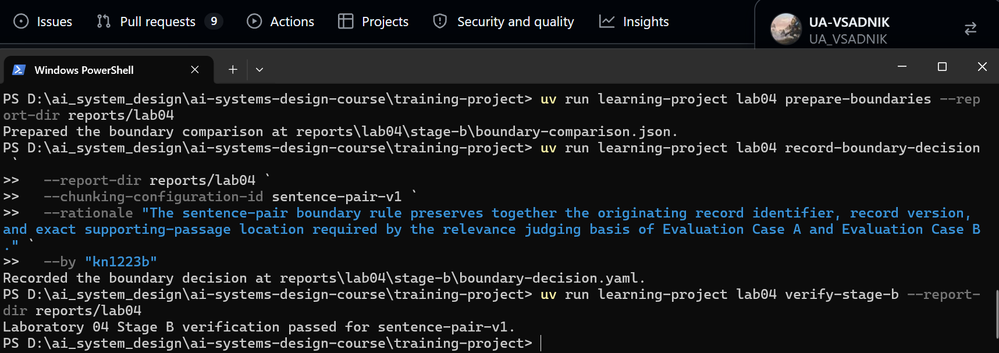
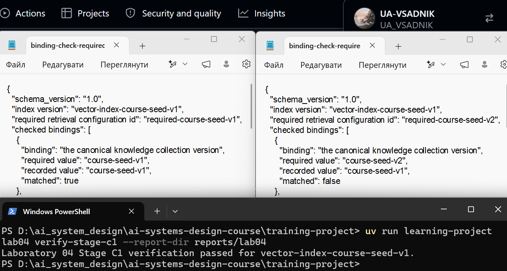
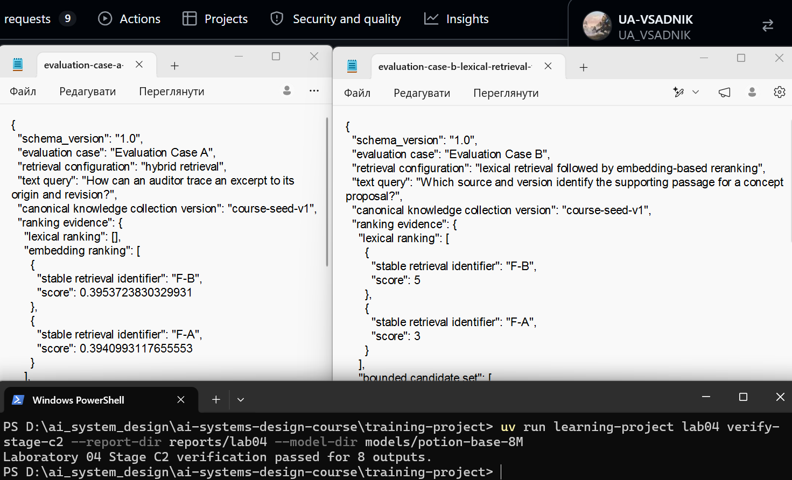
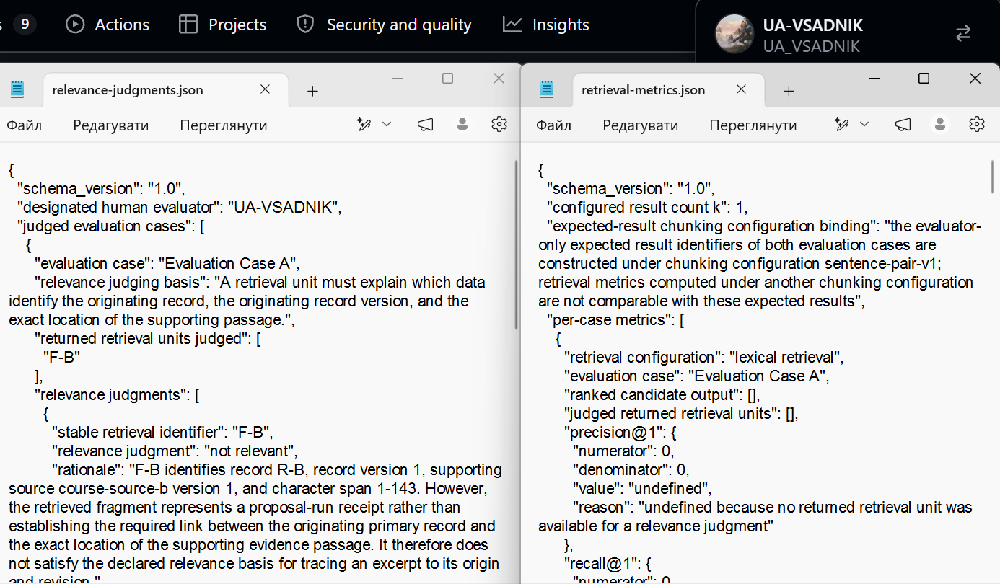
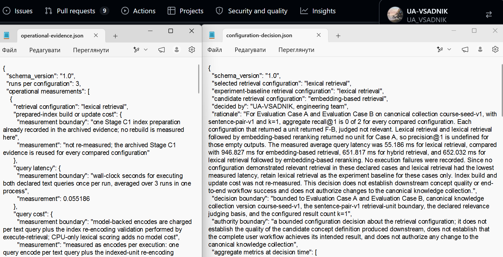

# Лабораторна робота 04

## Ідентифікація

- Прізвище та ім’я студента: Санчич Владислав
- Ідентифікатор студента: `kn1223b`
- URL форка: https://github.com/UA-VSADNIK/ai-systems-design-course
- Особиста гілка: `lab04/kn1223b`
- Статус завершення: `honest-partial`

Повний хеш остаточного коміту та результат перевірки мають міститися в окремому згенерованому `verification-report.json`. На момент підготовки цього звіту фінальний коміт і остаточна перевірка ще не виконані, тому ці дані не наведено.

## Мета роботи

Отримати свідчення, потрібні команді інженерів, щоб вирішити, чи має кандидатна конфігурація інформаційного пошуку — пошук на основі ембедингів (embedding-based retrieval) — замінити базову конфігурацію експерименту — лексичний пошук (lexical retrieval) — для оцінюваного використання операції інформаційного пошуку над канонічною колекцією знань `course-seed-v1`.

## Хід виконання

### Вибір межі одиниці інформаційного пошуку

Для канонічних записів `R-A` і `R-B` було порівняно конфігурації `sentence-pair-v1` та `fixed-72-v1`. У `sentence-pair-v1` сусідні речення об’єднуються парами без перекриття; у `fixed-72-v1` фрагменти формуються з обмеженням у 72 символи без перекриття.

Для `sentence-pair-v1` отримано одиниці `F-A` і `F-B`. `F-A` пов’язана із записом `R-A`, версією запису 1, джерелом `course-source-a` версії 1 і діапазоном символів `1-215`. `F-B` пов’язана із записом `R-B`, версією запису 1, джерелом `course-source-b` версії 1 і діапазоном `1-143`. Для `fixed-72-v1` утворено `F-A-72-1` (запис `R-A`, джерело `course-source-a`, символи `1-71`), `F-A-72-2` (`R-A`, `course-source-a`, `73-140`), `F-A-72-3` (`R-A`, `course-source-a`, `142-203`), `F-A-72-4` (`R-A`, `course-source-a`, `205-215`), `F-B-72-1` (`R-B`, `course-source-b`, `1-71`) та `F-B-72-2` (`R-B`, `course-source-b`, `73-143`). Усі фрагменти посилаються на версію 1 відповідного запису та версію 1 відповідного джерела. Усі фрагменти обох конфігурацій визначені як похідні артефакти інформаційного пошуку, а не члени канонічної колекції знань.

Було обрано `sentence-pair-v1`, оскільки ця межа зберігає разом ідентифікатор первинного запису, версію запису й точне місце підтвердного уривка, необхідні для оголошених випадків оцінювання. Рішення зафіксовано в `boundary-decision.yaml`; перевірка вибору межі одиниці інформаційного пошуку пройшла успішно. пройшла успішно. Опис узгоджується з `boundary-comparison.json` і `boundary-decision.yaml`.

Рисунок — `01-boundary-selection.png`

### Ембединги та векторний індекс

Було підготовлено ембединги для одиниць `F-A` і `F-B` та створено маніфест векторного індексу. Використано модель `minishlab/potion-base-8M`, ревізію `bf8b056651a2c21b8d2565580b8569da283cab23`, версію представлення `course-static-embed-v1`, розмірність 256 і простір `potion-base-8M@bf8b056651a2c21b8d2565580b8569da283cab23/course-static-embed-v1`.

Підготовлено індекс `vector-index-course-seed-v1` для колекції `course-seed-v1` із конфігурацією межі `sentence-pair-v1`. До індексу включено `F-A` і `F-B` з відповідними посиланнями походження. Перевірка прив’язок для `required-course-seed-v1` завершилася результатом `admissible`: усі перевірені значення збіглися. Перевірка для `required-course-seed-v2` завершилася результатом `stale`, оскільки потрібна версія колекції `course-seed-v2`, тоді як індекс прив’язаний до `course-seed-v1`. Цей індекс не використовувався як придатний для конфігурації v2.

Результат `required-course-seed-v1` дозволив перейти до виконання пошуку для відповідної версії колекції; застаріла прив’язка v2 засвідчила невідповідність версії колекції. Перевірка ембедингів, індексу та прив’язок до версій колекції пройшла успішно. Опис узгоджується з retrieval-unit-embeddings.json, index-manifest.json і обома файлами перевірки прив’язок.

Рисунок — `02-embedding-index.png`

### Порівняння конфігурацій інформаційного пошуку

Для Evaluation Case A та Evaluation Case B виконано пошук за чотирма конфігураціями: `lexical retrieval`, `embedding-based retrieval`, `hybrid retrieval` та `lexical retrieval followed by embedding-based reranking`. Усі виходи належать до колекції `course-seed-v1` і використовують межу `sentence-pair-v1`.

| Випадок | Конфігурація | Ранжований кандидатний вихід |
|---|---|---|
| A | `lexical retrieval` | Порожній |
| A | `embedding-based retrieval` | `F-B`, бал `0.395372` |
| A | `hybrid retrieval` | `F-B`, бал `1.000000` |
| A | `lexical retrieval followed by embedding-based reranking` | Порожній |
| B | `lexical retrieval` | `F-B`, бал `5` |
| B | `embedding-based retrieval` | `F-B`, бал `0.703931` |
| B | `hybrid retrieval` | `F-B`, бал `2.000000` |
| B | `lexical retrieval followed by embedding-based reranking` | `F-B`, бал `0.703931` |

Для кожного непорожнього виходу повернута одиниця `F-B` містила посилання походження на `R-B`, версію запису 1, джерело `course-source-b` версії 1 і діапазон `1-143`. Порожні виходи для випадку A є результатами пошуку без повернутих кандидатів, а не зафіксованими помилками виконання.

Перевірено всі вісім результатів пошуку, що дозволило перейти до суджень про релевантність. Опис узгоджується з вісьмома JSON-файлами ранжованих виходів. Загальна перевага жодної конфігурації цими результатами не встановлюється.

Рисунок — `03-retrieval-comparison.png`

### Судження про релевантність і метрики

Для обох випадків застосовано підставу оцінювання, за якою одиниця інформаційного пошуку має пояснювати, які дані ідентифікують первинний запис, версію первинного запису та точне місце розташування підтвердного уривка. У кожному випадку єдина повернута одиниця `F-B` отримала судження `not relevant`. Для випадку A вона описує квитанцію запуску пропозиції, але не встановлює потрібний зв’язок між первинним записом і точним місцем підтвердного уривка. Для випадку B метадані походження ідентифікують квитанцію та її місце в джерелі, але не встановлюють потрібний зв’язок із підтвердним уривком первинного запису.

Нижче наведено метрики для восьми виходів. Чисельники та знаменники відтворюють значення з `retrieval-metrics.json`.

| Випадок | Конфігурація | `precision@1` | `recall@1` |
|---|---|---:|---:|
| A | `lexical retrieval` | `0/0 = undefined` | `0/1 = 0.0` |
| A | `embedding-based retrieval` | `0/1 = 0.0` | `0/1 = 0.0` |
| A | `hybrid retrieval` | `0/1 = 0.0` | `0/1 = 0.0` |
| A | `lexical retrieval followed by embedding-based reranking` | `0/0 = undefined` | `0/1 = 0.0` |
| B | `lexical retrieval` | `0/1 = 0.0` | `0/1 = 0.0` |
| B | `embedding-based retrieval` | `0/1 = 0.0` | `0/1 = 0.0` |
| B | `hybrid retrieval` | `0/1 = 0.0` | `0/1 = 0.0` |
| B | `lexical retrieval followed by embedding-based reranking` | `0/1 = 0.0` | `0/1 = 0.0` |

Для порожнього виходу `precision@1` має значення `undefined`, оскільки не було повернуто одиниці для судження. Агреговані метрики для обох випадків:

| Конфігурація | Агрегований `precision@1` | Агрегований `recall@1` |
|---|---:|---:|
| `lexical retrieval` | `0/1 = 0.0` | `0/2 = 0.0` |
| `embedding-based retrieval` | `0/2 = 0.0` | `0/2 = 0.0` |
| `hybrid retrieval` | `0/2 = 0.0` | `0/2 = 0.0` |
| `lexical retrieval followed by embedding-based reranking` | `0/1 = 0.0` | `0/2 = 0.0` |

Очікуваним релевантним результатом для обох випадків був `F-A`; ці очікувані результати використовувалися лише для оцінювання і не передавалися операції інформаційного пошуку. Усі повернуті одиниці отримали судження, а арифметичну правильність восьми записів метрик перевірено успішно. Це дозволило використати перевірені метрики разом з операційними свідченнями для формування обмеженого рішення. Опис узгоджується з `relevance-judgments.json` і `retrieval-metrics.json`.

Рисунок — `04-relevance-metrics.png`

### Операційні свідчення та обмежене рішення

Операційні свідчення зібрано для чотирьох конфігурацій із трьома запусками на конфігурацію. Затримка вимірювалася як час виконання обох оголошених текстових запитів один раз за запуск і усереднювалася за трьома запусками в одному процесі.

| Конфігурація | Середня затримка запиту | Помилки виконання |
|---|---:|---|
| `lexical retrieval` | `0.055186` с | Немає |
| `embedding-based retrieval` | `0.946827` с | Немає |
| `hybrid retrieval` | `0.651817` с | Немає |
| `lexical retrieval followed by embedding-based reranking` | `0.652032` с | Немає |

Вартість побудови або оновлення підготовленого індексу під час цих вимірювань повторно не вимірювалася: використано раніше зафіксовані свідчення про побудову та стан індексу. Вартість запиту описана як кількість кодувань за виконання: одне кодування запиту для кожного текстового запиту та повторне кодування індексованих одиниць для перевірки відповідності оголошеному енкодеру; лексичне оцінювання на CPU не додає вартості моделі. Пікове споживання ресурсів у процесі не інструментувалося. Зафіксовано повторне використання локальної моделі в одному процесі, відсутність мережевого доступу та додаткового обладнання.

Зафіксовано рішення залишити `lexical retrieval` базовою конфігурацією експерименту. Для обох випадків і всіх конфігурацій агрегований `recall@1` становить `0/2`; кожен непорожній вихід містив `F-B`, оцінений як нерелевантний. Лексичний пошук мав найменшу виміряну середню затримку — `0.055186` с. Рішення обмежене Evaluation Case A та Evaluation Case B, версією колекції `course-seed-v1`, межею `sentence-pair-v1`, оголошеною підставою оцінювання та `k=1`. Воно не встановлює якості кандидатного визначення поняття на наступному етапі, успішності повного робочого процесу користувача й не дозволяє змінювати канонічну колекцію знань.

Опис узгоджується з `operational-evidence.json` і `configuration-decision.json`. Операційні вимірювання не входять до чисельників або знаменників метрик релевантності.

Рисунок — `05-operational-decision.png`

### Остаточна перевірка

Арифметичну правильність восьми записів метрик перевірено успішно. Перевірка підтвердила відповідність розрахунків зафіксованим судженням про релевантність і ранжованим виходам.

Завершення звіту та фінальна перевірка ще не виконані: остаточний коміт не створено, точний HEAD особистої гілки не перевірено, а `verification-report.json` і скриншот `06-final-verification.png` ще не створені. Тому відповідність фінального статусу, коміту й HEAD машинному звіту наразі не підтверджена. Після створення коміту необхідно виконати фінальну перевірку доменних артефактів, структури звіту, шести скриншотів і незмінності закомічених свідчень. До цього етапу робота має статус `partial-complete`.

Рисунок — `06-final-verification.png` (скриншот ще не створено)

## Висновки

У ході виконання лабораторної роботи обрано межу `sentence-pair-v1`, підготовлено ембединги та векторний індекс для `course-seed-v1`, виконано вісім ранжованих виходів для чотирьох конфігурацій, зафіксовано судження про релевантність і розраховано метрики. Також зібрано операційні свідчення та зафіксовано обмежене рішення залишити `lexical retrieval` базовою конфігурацією експерименту.

Для всіх конфігурацій агрегований `recall@1` дорівнює `0/2`, а найменшу виміряну затримку показав лексичний пошук. Отже, отримані результати не підтвердили, що кандидатна конфігурація на основі ембедингів має замінити базову конфігурацію для оголошених випадків. Мету роботи щодо збору свідчень і формування обмеженого рішення досягнуто частково: рішення зафіксовано, але фінальний коміт, перевірка точного HEAD і остаточна перевірка зі скриншотом ще не виконані.
