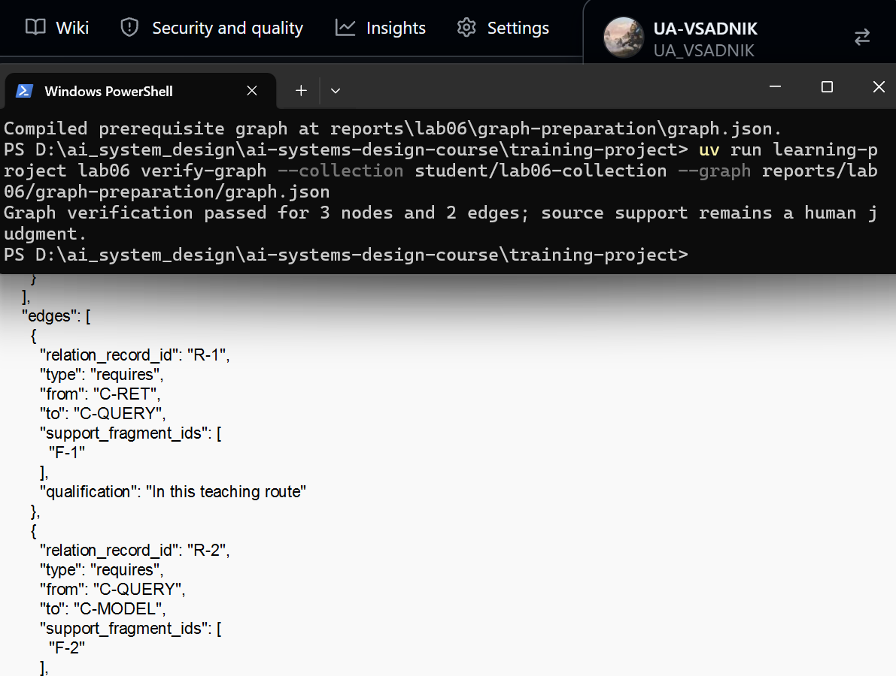
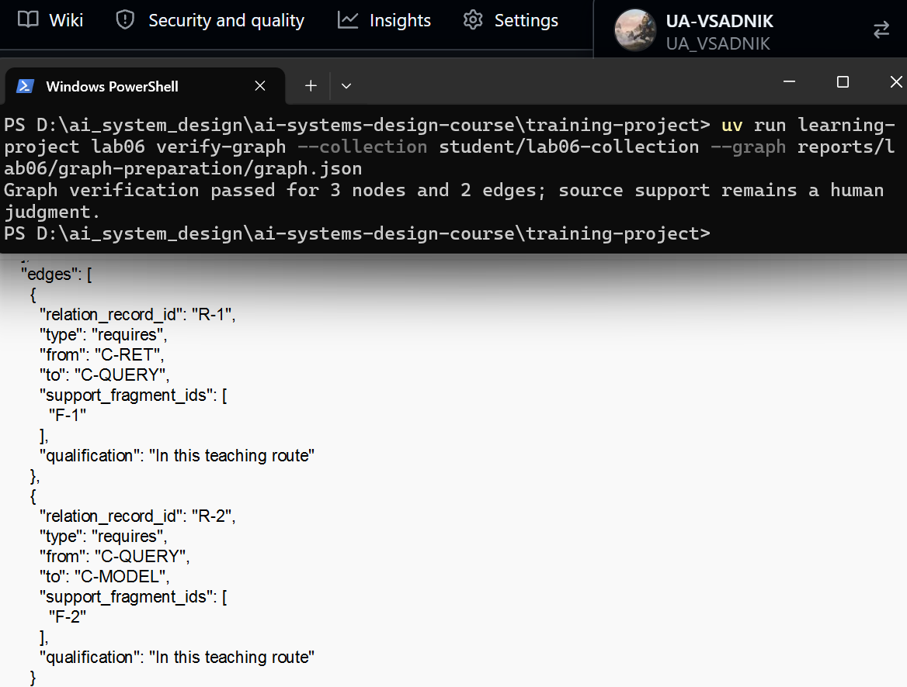
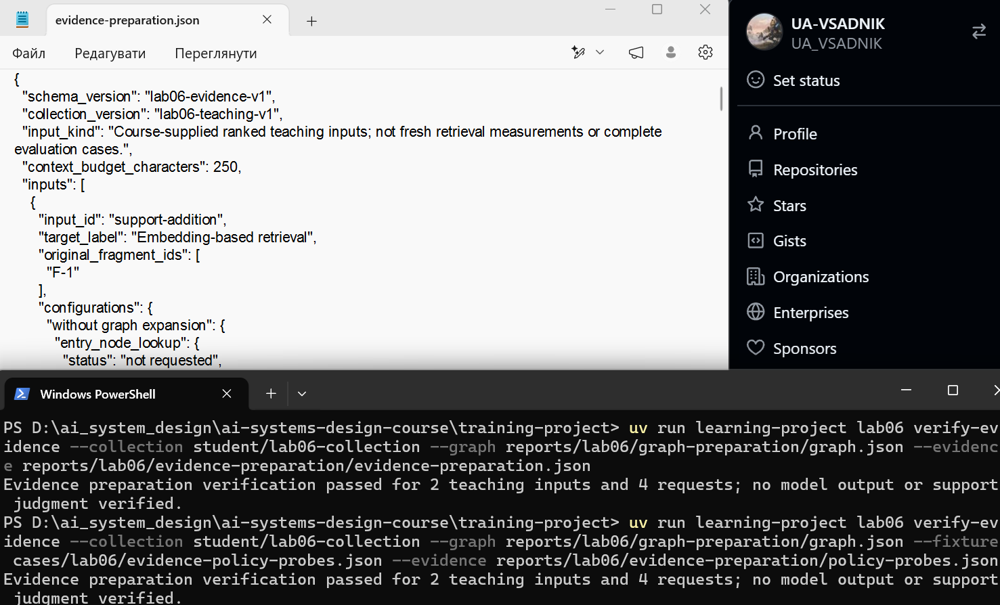
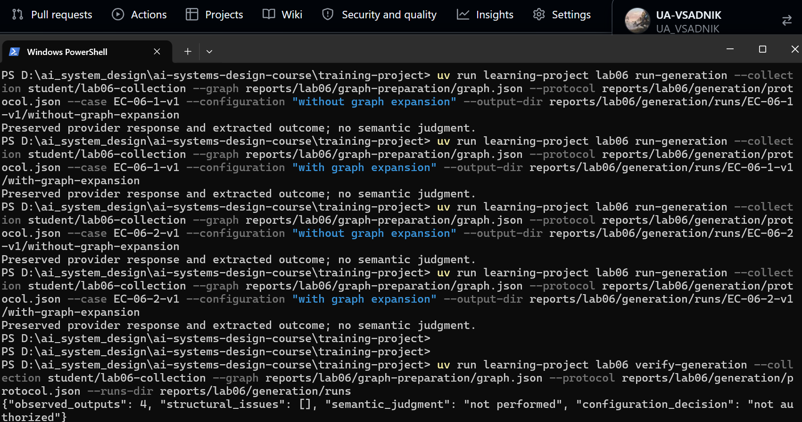
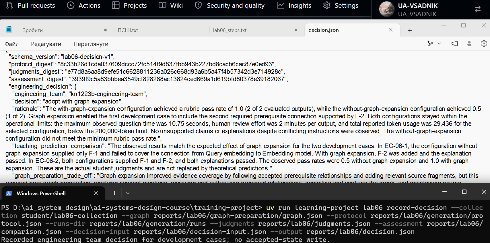
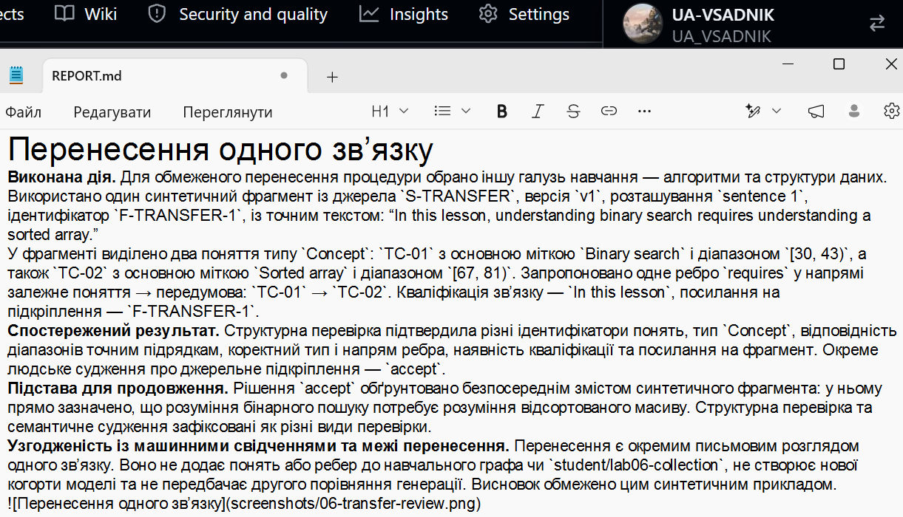
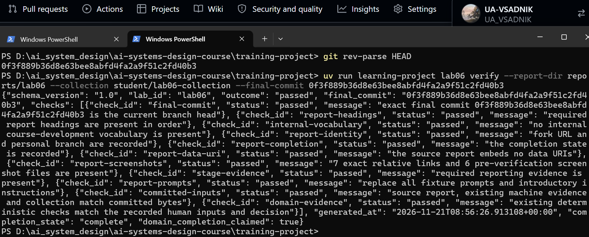

# Лабораторна робота 06

## Ідентифікація

- Прізвище та ім'я студента: Санчич Владислав
- Ідентифікатор студента: kn1223b
- URL форка: https://github.com/UA-VSADNIK/ai-systems-design-course
- Особиста гілка: `lab06/kn1223b`
- Статус завершення: `complete`

Повний хеш остаточного коміту та результат остаточної перевірки мають бути зафіксовані в окремому згенерованому `verification-report.json` після виконання фінальних процедур.

## Мета роботи

Метою лабораторної роботи є дослідження способу подання та використання графа передумов для доповнення свідчень, отриманих інформаційним пошуком. Робота передбачає збереження напрямлених залежностей між поняттями та посилань на джерельні фрагменти, виконання обмеженого обходу графа без ототожнення такого обходу з логічним виведенням, а також проведення операції пояснення передумов із використанням мовної моделі.

Передбачено порівняння двох конфігурацій підготовки свідчень — без розширення та з розширенням вибірки вузлів графа. Згенеровані пояснення або відмови оцінюються окремо за покриттям джерельними свідченнями та якістю відповіді. На підставі обмежених випадків для розроблення формується рішення щодо конфігурації з явним урахуванням меж експерименту.

## Хід виконання

### Підготовка прийнятого графа

**Виконана дія.** Підготовлено файл розгляду пропозицій зв’язків `graph-preparation/review.json`. Для згадок понять виконано окреме зіставлення з ідентифікаторами понять: п’ять згадок отримали результат `match`, а згадка `M-6` залишилася `unresolved`, оскільки фрагмент `F-3` не давав змоги однозначно визначити поняття. Пропозиції `P-1` і `P-2` прийнято, обернену пропозицію `P-3` відхилено, а `P-4` заблоковано через нерозв’язану кінцеву точку.

**Спостережений результат.** До прийнятого стану внесено три поняття: `C-RET` (Embedding-based retrieval), `C-QUERY` (Query embedding) і `C-MODEL` (Embedding model). Скомпільований граф містить два напрямлені ребра типу `requires`:
- `R-1`: `C-RET` → `C-QUERY`, підкріплення `F-1`;
- `R-2`: `C-QUERY` → `C-MODEL`, підкріплення `F-2`.

Для обох ребер збережено кваліфікацію `In this teaching route` та походження джерельних фрагментів. Згадка `M-6` не перетворена на прийняту асоціацію.

**Підстава для продовження.** Прийняття двох ребер обґрунтоване текстами `F-1` і `F-2`, які прямо формулюють відповідні залежності. Обернене твердження не відповідало напряму, наведеному у `F-1`, а неоднозначна згадка з `F-3` не мала достатньої підстави для прив’язування до конкретного поняття.

**Узгодженість із машинними свідченнями.** Результати відображені у `reports/lab06/graph-preparation/review.json`, `student/lab06-collection/accepted.json` та `reports/lab06/graph-preparation/graph.json`. Команда `verify-graph` підтвердила структуру графа з трьома вузлами та двома ребрами. Структурна перевірка підтверджує коректність представлення, але не замінює людського судження про джерельне підкріплення.

### Обмежені запити до графа

**Виконана дія.** Виконано обмежені запити шляхів від `C-RET` із глибиною один і два ребра, а також повну інспекцію вихідних ребер для перевірки прямого зв’язку між `C-RET` і `C-MODEL`. Додатково розглянуто відповідний шаблон Cypher для пошуку простих напрямлених шляхів довжиною від одного до двох ребер.

**Спостережений результат.** Для глибини в одне ребро отримано шлях `C-RET` → `C-QUERY` через `R-1` із підкріпленням `F-1`. Для глибини у два ребра отримано продовження `C-RET` → `C-QUERY` → `C-MODEL` через `R-1` і `R-2`, із підкріпленнями `F-1` та `F-2`. Перевірка вихідних ребер `C-RET` не виявила збереженого прямого ребра до `C-MODEL`.

**Підстава для продовження.** Двореберний шлях зберігає проміжне поняття `C-QUERY`, напрям кожного ребра та посилання на джерельне підкріплення. Відсутність прямого збереженого ребра між `C-RET` і `C-MODEL` не означає відсутності будь-якого предметного зв’язку. Так само позначка `depth limit: continuation not inspected` означає, що продовження за межами заданої глибини не перевірялося, а не те, що подальших ребер немає.

**Узгодженість із машинними свідченнями.** Результати збережено у `reports/lab06/graph-query/paths-1.json`, `paths-2.json` і `direct-edge.json`. Повторна перевірка графа підтвердила три вузли та два ребра. Запит Cypher описує структуру напрямлених шляхів, але сам по собі не встановлює семантичної істинності залежностей.

### Підготовка джерельних свідчень

**Виконана дія.** Підготовлено парні запити до моделі для двох випадків розроблення у конфігураціях без розширення графа та з розширенням графа. Окремо перевірено політики розширення на контрольних сценаріях дублювання фрагментів і нерозв’язаної цільової згадки. Виконано структурну перевірку підготовлених запитів.

**Спостережений результат.** Для випадку `support-addition` без розширення було вибрано `F-1`; із розширенням до кандидатів і свідчень додано `F-2`. Для випадку `budget-exclusion` розширення виявило `F-2` як додаткового кандидата, однак цей фрагмент не потрапив до наданих свідчень через обмеження контекстного бюджету. Початкові свідчення `F-1` і `F-3` збережено. У сценарії `duplicate-only` повторне виявлення не створило дубльованого фрагмента. У сценарії `unresolved-target` відсутність розв’язаної асоціації вхідного поняття не дала підстав для розширення.

**Підстава для продовження.** Розширення графа може додати релевантний фрагмент, але не скасовує обмеження контекстного бюджету та не повинно створювати дублікати або вгадувати нерозв’язані поняття. До запиту моделі передавалися обмежена інструкція, відібрані джерельні свідчення та контракт очікуваного результату. Оцінювальні матеріали не включалися до запитів як додаткове джерельне підкріплення.

**Узгодженість із машинними свідченнями.** Підготовку зафіксовано у `reports/lab06/evidence-preparation/evidence-preparation.json` та `reports/lab06/evidence-preparation/policy-probes.json`. Обидві перевірки `verify-evidence` завершилися успішно: перевірено два навчальні входи та чотири запити в кожному відповідному наборі. Ці перевірки підтверджують підготовку запитів, а не правильність майбутніх відповідей моделі.

### Спостережені виходи операції

**Виконана дія.** Підготовлено протокол генерації та виконано чотири окремі запуски моделі `gemini-3.8-flash-low`: для двох випадків розроблення `EC-06-1-v1` і `EC-06-2-v1`, кожен у конфігураціях без розширення графа та з розширенням графа. Для кожної позиції збережено запит, відповідь провайдера, витягнутий результат і метадані запуску.

**Спостережений результат.** Усі чотири позиції містили згенеровані пояснення передумов. Для `EC-06-1-v1` без розширення було надано лише `F-1`, тому пояснення охопило зв’язок `C-RET` → `C-QUERY`, але не охопило наступний зв’язок `C-QUERY` → `C-MODEL`. Для `EC-06-1-v1` з розширенням, а також для обох конфігурацій `EC-06-2-v1`, у свідченнях були `F-1` і `F-2`; відповіді містили обидва відповідні твердження з посиланнями на фрагменти. Структурних проблем під час перевірки чотирьох результатів не виявлено.

**Підстава для продовження.** Усі чотири виходи були збережені та структурно перевірені, тому їх можна було передати на окремий людський розгляд. Структурна наявність правильних ідентифікаторів цитат не розглядалася як автоматичний доказ повноти пояснення або джерельної підтримки.

**Узгодженість із машинними свідченнями.** Параметри запусків зафіксовано у `reports/lab06/generation/protocol.json`, а фактичні артефакти — у `reports/lab06/generation/runs/`. Команда `verify-generation` повернула `observed_outputs: 4`, `structural_issues: []`, `semantic_judgment: not performed` і `configuration_decision: not authorized`. Отже, на цьому етапі було підтверджено структуру виходів, але ще не виконано семантичне оцінювання.

### Незалежні судження та обмежене рішення

**Виконана дія.** Для чотирьох позицій підготовлено та заповнено людські судження у `reports/lab06/judgments.json`. Покриття двох обов’язкових зв’язків оцінювалося окремо від якості згенерованої відповіді. Після цього виконано оцінювання порівняння конфігурацій та сформовано вхідні дані інженерного рішення.

**Спостережений результат.** Для конфігурації без розширення графа одна з двох відповідей пройшла рубрику оцінювання: `1/2`, частка `0,5`. Для конфігурації з розширенням графа пройшли обидві відповіді: `2/2`, частка `1,0`. Невиконаних суджень не залишилося. В усіх чотирьох позиціях не виявлено непідкріплених тверджень або пояснень попри конфліктну інструкцію.

Операційні показники також залишилися в установлених межах. Максимальний зафіксований час запитання становив приблизно `10,75` секунди. Людський розгляд кожної позиції становив `2` хвилини. Сумарне повідомлене використання токенів становило `29 244` для конфігурації без розширення та `29 436` для конфігурації з розширенням.

**Підстава для рішення.** Конфігурація без розширення не досягла мінімальної частки проходження рубрики `1,0`. Конфігурація з розширенням досягла цієї частки та виконала умови щодо блокувальних невдач, часу запитання, людського розгляду й використання токенів. Тому дозволено гілку `adopt with graph expansion`.

Фактичне порівняння узгоджується з очікуваним ефектом розширення в цих двох випадках: у `EC-06-1-v1` додавання `F-2` забезпечило покриття другого зв’язку, тоді як у `EC-06-2-v1` обидві конфігурації вже мали обидва потрібні фрагменти. Компроміс полягає в тому, що розширення підвищує покриття, але потребує попереднього розв’язання згадок, людського розгляду зв’язків, компіляції, перевірки та подальшого супроводу графа. Крім того, додатковий фрагмент може бути виключений через контекстний бюджет. Час підготовки графа не вимірювався.

**Узгодженість із машинними свідченнями.** Людські оцінки містяться у `reports/lab06/judgments.json`, агреговані показники — у `reports/lab06/comparison.json`, а запис інженерного рішення — у `reports/lab06/decision.json`. У рішенні зафіксовано `adopt with graph expansion` лише для досліджених випадків розроблення. Воно не є дозволом на промислове розгортання або зміну прийнятої колекції.

### Перенесення одного зв’язку

**Виконана дія.** Для обмеженого перенесення процедури обрано іншу галузь навчання — алгоритми та структури даних. Використано один синтетичний фрагмент із джерела `S-TRANSFER`, версія `v1`, розташування `sentence 1`, ідентифікатор `F-TRANSFER-1`, із точним текстом: “In this lesson, understanding binary search requires understanding a sorted array.”

У фрагменті виділено два поняття типу `Concept`: `TC-01` з основною міткою `Binary search` і діапазоном `[30, 43)`, а також `TC-02` з основною міткою `Sorted array` і діапазоном `[67, 81)`. Запропоновано одне ребро `requires` у напрямі залежне поняття → передумова: `TC-01` → `TC-02`. Кваліфікація зв’язку — `In this lesson`, посилання на підкріплення — `F-TRANSFER-1`.

**Спостережений результат.** Структурна перевірка підтвердила різні ідентифікатори понять, тип `Concept`, відповідність діапазонів точним підрядкам, коректний тип і напрям ребра, наявність кваліфікації та посилання на фрагмент. Окреме людське судження про джерельне підкріплення — `accept`.

**Підстава для продовження.** Рішення `accept` обґрунтовано безпосереднім змістом синтетичного фрагмента: у ньому прямо зазначено, що розуміння бінарного пошуку потребує розуміння відсортованого масиву. Структурна перевірка та семантичне судження зафіксовані як різні види перевірки.

**Узгодженість із машинними свідченнями та межі перенесення.** Перенесення є окремим письмовим розглядом одного зв’язку. Воно не додає понять або ребер до навчального графа чи `student/lab06-collection`, не створює нової когорти моделі та не передбачає другого порівняння генерації. Висновок обмежено цим синтетичним прикладом.

### Остаточна перевірка

**Виконана дія.** Після фіксації остаточного звіту та інших матеріалів лабораторної роботи комітом передбачено виконання фінальної перевірки командою `uv run learning-project lab06 verify` із передаванням повного хешу коміту через параметр `--final-commit`.

**Очікуваний результат.** Фінальна перевірка має підтвердити, що точний HEAD особистої гілки відповідає переданому хешу, структура звіту та необхідні свідчення відповідають вимогам, а закомічені матеріали узгоджені з фактичним вмістом файлів.

**Підстава для завершення.** Успішне проходження фінальної перевірки є завершальним підтвердженням узгодженості звіту, машинних свідчень і навчальної колекції. Результат перевірки та повний хеш коміту фіксуються в окремому `verification-report.json`.

**Узгодженість із машинними свідченнями.** Після виконання перевірки її результат буде збережено у `reports/lab06/verification-report.json`. Скріншот `screenshots/07-final-verification.png` має відображати успішний результат перевірки, ідентичність облікового запису та системну дату. Перевірка стосується конкретного коміту й не є дозволом на промислове розгортання або узагальнення результатів на інші випадки.

### Межа зупинки

Основні етапи лабораторної роботи виконано: підготовлено та перевірено граф передумов, виконано обмежені запити, підготовлено джерельні свідчення, проведено генерацію та незалежне оцінювання, сформовано обмежене інженерне рішення і розглянуто перенесення одного зв’язку до іншої навчальної галузі.

Висновки обмежені двома випадками розроблення та одним синтетичним прикладом перенесення. Вони не є підтвердженням придатності підходу для промислового розгортання або всіх можливих запитів. Навчальну колекцію в межах перенесення не змінювали, додаткову когорту генерації та повторне порівняння не проводили.

## Висновки

У лабораторній роботі підготовлено та перевірено граф передумов із трьома поняттями й двома підкріпленими ребрами, виконано обмежені запити до графа, сформовано парні набори джерельних свідчень і отримано чотири результати генерації. Після незалежного людського оцінювання конфігурація з розширенням графа досягла частки проходження рубрики `1,0`, тоді як конфігурація без розширення — `0,5`. Для досліджених випадків зафіксовано обмежене інженерне рішення `adopt with graph expansion`.

Також виконано обмежене перенесення одного зв’язку до іншої галузі навчання без зміни навчальної колекції. Основні завдання лабораторної роботи виконано, а результати оформлено відповідно до встановлених вимог. Сформоване інженерне рішення обмежене двома дослідженими випадками розроблення та не є дозволом на промислове розгортання або узагальнення на інші запити.
